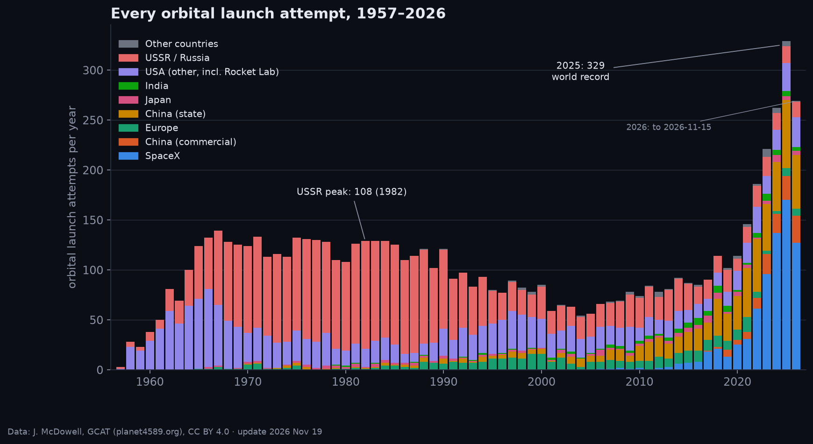
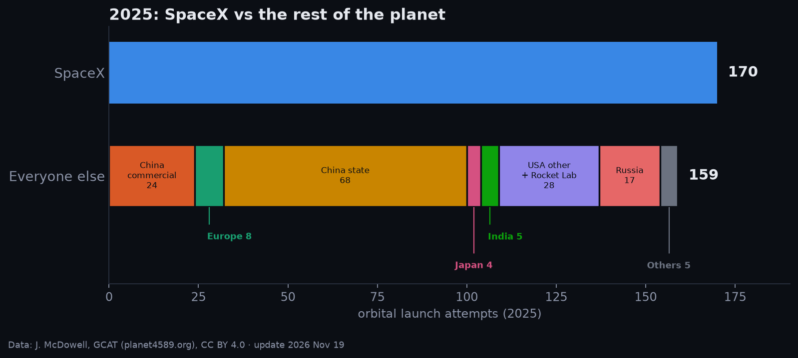
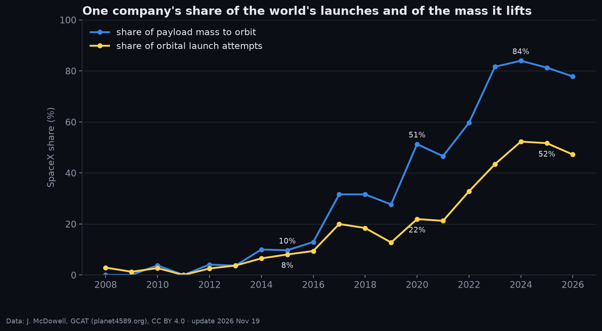
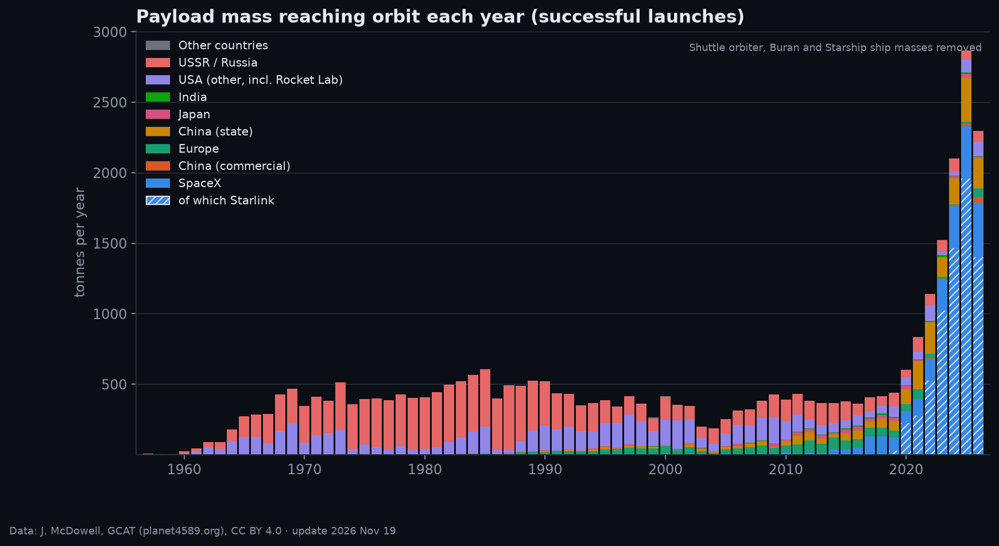
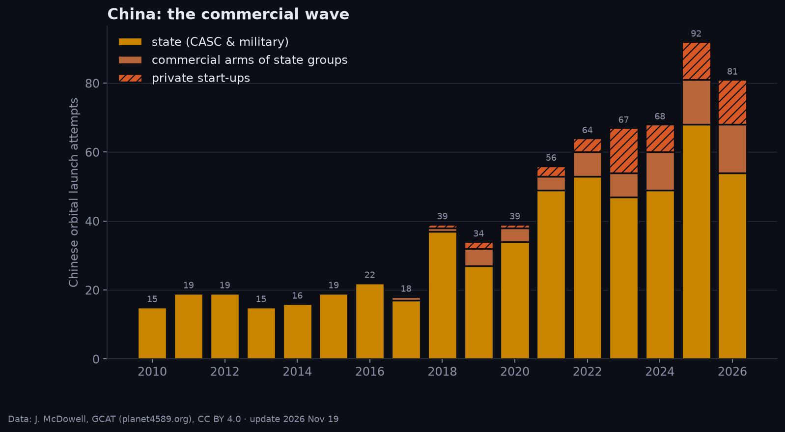
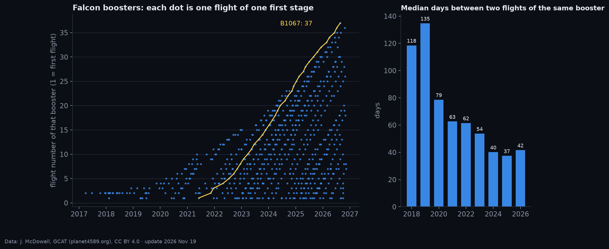
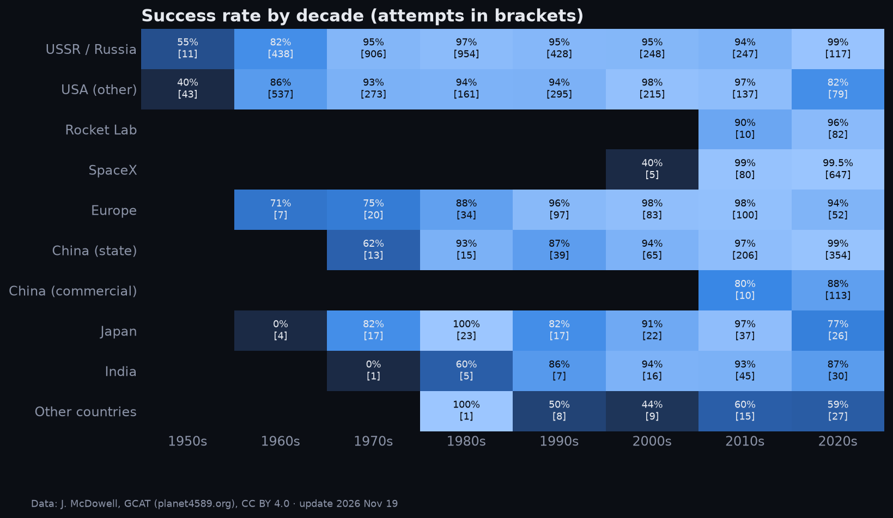

# space-launches-in-data

**Every orbital launch attempt in history, 1957–2026, from Jonathan McDowell's General Catalog of Artificial
Space Objects (GCAT).** Who launches, how often, how reliably, how much mass, and how often the same rocket
flies again — computed from one public catalogue with code you can rerun when it updates.

Made for the [Kister Space](https://www.youtube.com/@KisterSpace) channel. Snapshot: GCAT release 1.8.9,
data update **2026 Nov 19** (2026 is a partial year).



## Findings (GCAT snapshot of 2026 Nov 19)

| | number | how it is counted |
|---|---|---|
| Orbital launch attempts, Oct 1957 – Nov 2026 | **7,431** (6,923 successes) | `LaunchCode` O\* or D\*, outcome S or F; pad explosions and aborts are not launches |
| Busiest year ever | **2025: 329** attempts | previous Cold-War peak: 139 (1967) |
| USSR's busiest year | **108** attempts (1982) | the USSR/Russia total is still the largest: 3,349 attempts |
| SpaceX in 2025 | **170** attempts vs **159** for everyone else combined | 165 Falcon 9 + 5 Starship test flights; Falcon 9 alone also beats the rest |
| SpaceX in 2024 | 137 vs 125 | first year SpaceX out-launched the rest of the world |
| SpaceX in 2026 (to Nov 19) | 127 vs 142 | the rest of the world is ahead again, mostly China |
| Falcon 9 record | 701 attempts, **2 failures** (2015, 2024); 348 successes in a row since July 2024 | the 2016 Amos-6 pad explosion is not a launch in GCAT |
| Starlink satellites placed in orbit | **13,080**, i.e. 45.6 % of all 28,653 payloads ever | humanity orbited 8,635 payloads from Sputnik to the first Starlink launch (24 May 2019) |
| Payload mass in orbit, 2025 | **2,867 t**; SpaceX 81 %; Starlink alone 1,958 t | pre-2020 record year: 608 t (1985) |
| SpaceX share of all payload mass since 1957 | 9,044 t of 33,516 t = **27 %** | Shuttle orbiter / Buran / Starship ship masses removed |
| Falcon boosters | 72 cores, 691 flights, 639 of them re-flights | B1067 flew 37 times; fastest turnaround 9.15 days (B1088, March 2025) |
| Re-flown Falcon 9 boosters | 28 % of 2017 launches → **95 %** in 2025 | median turnaround: 135 days (2019) → 37 days (2025) |
| China 2025 | 92 attempts: 68 state, 13 commercial arms of state groups, 11 private start-ups | private start-ups since 2018: 56 attempts, 78.6 % success |













### Animations

`media/launch_race_short.mp4` (1080×1920, 31 s) and `media/launch_race_longform.mp4` (1920×1080, 58 s):
orbital launch attempts in the previous 12 months, by operator, month by month from 1958 to October 2026.

## Cross-check against Wikipedia

`worldspace/crosscheck.py` compares GCAT with the by-country tables of Wikipedia's *2024 in spaceflight* and
*2025 in spaceflight* (country of rocket origin; Electron counts as USA):

| | GCAT attempts / successes | Wikipedia launches / successes | why they differ |
|---|---|---|---|
| 2025 world | 329 / 318 | 330 / 317 | Wikipedia counts a Kuaizhou-1A failure that GCAT records as a pad explosion on 1 March 2025 (`OE`, not a launch); Wikipedia scores 3 of the 5 Starship flights of 2025 as failures, GCAT 2 |
| 2024 world | 262 / 256 | 261 / 253 | GCAT counts Starship flights 4, 5 and 6 as orbital-class attempts, Wikipedia flights 3 and 6; Wikipedia's success column leaves out partial failures (Ariane 6's first flight, one Long March 2C/YZ-1S) |

Every other region (China, Russia, Europe, India, Japan, others) agrees exactly on the number of launches.

## Method in brief

* **Launches**: `tsv/launch/launch.tsv`, rows whose `LaunchCode` starts with O (orbital) or D (deep space) and
  whose outcome letter is S or F. Success = S (McDowell's success fraction ≥ 0.75).
* **Operator**: the `Agency` code resolved through `tsv/tables/orgs.tsv` (`StateCode`). SpaceX and Rocket Lab
  are split out; Europe = France/Arianespace, ESA, ELDO, Germany, Italy, UK.
* **China state vs commercial**: GCAT's launch-service code (`Group` column: G = government rocket; C, CO, CG,
  CX = commercial forms). Commercial launches are further split into private start-ups (LandSpace, Galactic
  Energy, iSpace, Space Pioneer, Orienspace, OneSpace) and commercial arms of state groups (China Rocket Co.,
  ExPace, CAS Space, CGWIC); that split is our classification.
* **Mass**: GCAT `OrbPay` (tonnes in orbit, which McDowell flags "use with caution"). GCAT includes the Space
  Shuttle orbiter, Buran and the Starship ship in it; we subtract their catalogue masses (12,911 t of Shuttle
  orbiters) and, for Starship, keep only catalogued satellites.
* **Payload counts**: `satcat`, `satcat100k` and `auxcat` objects of SatType `P` excluding aliases and
  non-standard payloads (`PA`, `PX`), for successful launches.
* **Boosters**: Falcon core serials and flight numbers parsed from `Flight_ID` (`B1067.37`) and, for Falcon
  Heavy side cores, `FlightCode`. The flight numbers increment by exactly one for every core (a test checks it).
* The community r/SpaceX API (`api.spacexdata.com`) answered HTTP 522 on 2026-11-20, so it was not used; GCAT
  alone carries the booster history.

## Run it

```bash
pip install -e .            # pandas, numpy, matplotlib; ffmpeg on PATH for --video
python -m worldspace        # downloads ~40 MB of GCAT tables into data/world_space/raw, rebuilds everything
python -m worldspace --video --lang es   # Spanish figures and animations
pytest
```

`data/world_space/derived/` holds the tables behind every number above (`facts.json`,
`orbital_launches.csv`, `falcon_booster_flights.csv`, per-year tables, the Wikipedia comparison).

## Limitations

* 2026 is partial (to 2026 Nov 19). Payload counts for the last weeks may grow as objects are catalogued.
* "Orbital attempt" follows GCAT: some Starship test flights with slightly negative perigee are included,
  others are not. SpaceX totals therefore include 12 Starship flights (2024–2026).
* `OrbPay` is auto-generated by GCAT from its payload tables; treat single-launch masses as approximate.
* Groups are by launch operator, not by rocket origin or launch site (Soyuz launched by Arianespace from
  Kourou counts as Europe).

## Data and licence

Data: **McDowell, J., 2020: General Catalog of Artificial Space Objects, https://planet4589.org/space/gcat**,
released under [CC BY 4.0](https://creativecommons.org/licenses/by/4.0). The derived tables in `data/` are
adapted from GCAT (filtered, joined and aggregated) and remain under CC BY 4.0 with that attribution. The raw
GCAT files are not stored here; the code downloads them from planet4589.org.
Wikipedia tables used for the cross-check are CC BY-SA 4.0 and are only read, not redistributed.

Code: MIT (see `LICENSE`).
